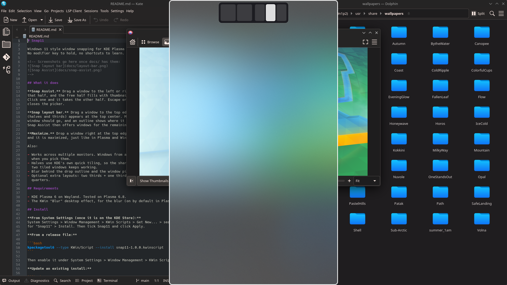
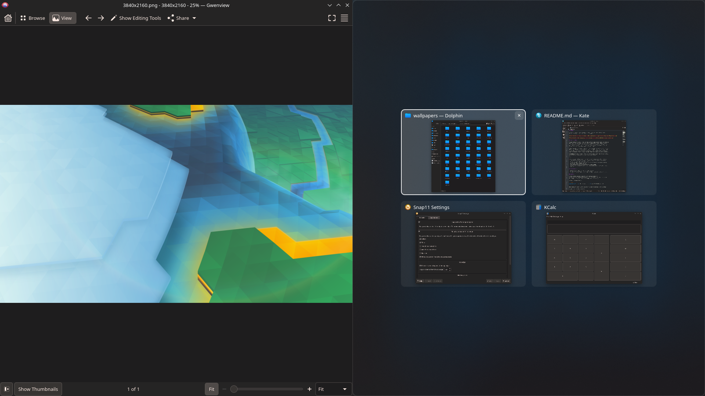

<p align="center">
  
</p>

<h1 align="center">Snap11</h1>

<p align="center">
  Windows 11 style window snapping for KDE Plasma 6, made for the mouse.<br>
  No modifier key to hold, no shortcuts to learn.
</p>





## What it does

**Snap Assist.** Drag a window to the left or right screen edge. It snaps to
that half (near a corner: to that quarter), and the free part fills with
cards of your other windows: icon and title on top, thumbnail below. Click
one and it takes that part. Hovering a card highlights it and shows a close
button; arrow keys and Enter work too. Escape or a click anywhere else
closes Snap Assist. If a window is already snapped into the free part, no
cards appear, like in Windows.

**Fill available space.** With a window already snapped against one side
(a half, a third, two thirds), drag another window to the opposite edge:
it takes exactly the space that is left, like in Windows.

**Snap bar.** As soon as you drag a window, a small bar slides in at the
top center of the screen, like in Windows 11. Drag the window onto it and it
opens up with Windows' layouts: 50/50, 66/33, 33/33/33, half + two quarters,
quarters and 25/50/25 (the three-column ones on screens 1920 px and wider,
like Windows). Move over the zone where the window should go, and a preview
shows where it will land. Drop it there. Snap Assist then offers windows for
the remaining zones, one after another, while the zones still to fill show
as empty placeholders. The zones are KDE's own tiles, so dragging the border
between two windows resizes both.

**Maximize.** Drop a window right at the top edge, away from the bar, and it
is maximized, just like in Plasma and Windows.

Also:

- Works across multiple monitors, including the edges where two monitors
  meet (KDE itself only snaps at the outer edges). Windows from another
  screen move over when you pick them.
- Halves and quarters use KDE's own quick tiling, so the shared resize
  handle between two tiled windows keeps working.
- Looks like Windows 11: the drop preview and Snap Assist are frosted
  glass with rounded corners, floating a little inside the screen; the bar
  and the notice are Windows flyouts with a shadow; hover, focus and close
  buttons behave like in Windows. Light or dark and the accent color follow
  your system settings, like in Windows.
- Optional extra layout: one third + two thirds (not in Windows).

## Requirements

- KDE Plasma 6 on Wayland. Tested on Plasma 6.8.
- The KWin "Blur" desktop effect, for the frosted glass behind the drop
  preview and Snap Assist (on by default in Plasma).

## Install

**From System Settings (once it is on the KDE Store):**
System Settings > Window Management > KWin Scripts > Get New... > search
for "Snap11" > Install. Then tick Snap11 and click Apply.

**From a release file:**

```bash
kpackagetool6 --type KWin/Script --install snap11-1.4.0.kwinscript
```

Then enable it under System Settings > Window Management > KWin Scripts.

**Update an existing install:**

```bash
kpackagetool6 --type KWin/Script --upgrade snap11-1.4.0.kwinscript
```

Log out and back in after an update. KWin keeps the old version in memory
until then.

### Two settings to change

Plasma has its own edge snapping with its own look. Turn it off so Snap11
takes over the edges (it maximizes and tiles by itself). While it is still
on, Snap11 shows a notice in the bottom right corner.

System Settings > Screen Edges > turn off **"Maximize: Drag windows to top
edge"** and **"Tile: Drag windows to the left or right edge"**.

Or in a terminal:

```bash
kwriteconfig6 --file kwinrc --group Windows --key ElectricBorderMaximize false
```

```bash
kwriteconfig6 --file kwinrc --group Windows --key ElectricBorderTiling false
```

```bash
qdbus6 org.kde.KWin /KWin reconfigure
```

## Settings

System Settings > Window Management > KWin Scripts > Snap11 > configure
button.

- **Behavior:** turn Snap Assist, edge and corner snapping and the layout
  bar on or off, choose the layouts in the bar, maximize at the top edge,
  trigger distances, include minimized windows, only offer windows from the
  same screen.
- **Appearance:** layout size in the bar, maximum thumbnail size in Snap
  Assist. Everything else looks like Windows 11; light or dark and the
  accent color come from your system settings.

## Known limits

- Only tested on Wayland. Plasma 6.6 on X11 is untested.
- No snap groups yet (minimizing or resizing a group of snapped windows
  together).
- KWin blurs behind a script's window only as a whole rectangle, so a hint
  of blur shows just outside the rounded corners.
- The drop preview is drawn above the window you drag (in Windows the
  window stays on top).

## Troubleshooting

See what the script is doing:

```bash
journalctl --user -f | grep snap11
```

After a KWin update, if something looks off, log out and back in once.

## Development

`./reload.sh` loads a fresh copy of the script into the running KWin;
`./reload.sh test` also opens the bar and Snap Assist by themselves.

`tools/preview` runs the real QML without KWin, against stand-ins for the
KDE modules, on a virtual display: scenarios drag windows, press keys,
check the result and save screenshots.

```bash
pip install PySide6-Essentials
```

```bash
./tools/preview/run.sh all
```

It needs `xvfb-run` and Mesa. Screenshots land in `dist/preview`.

## License

MIT, see [LICENSE](LICENSE).
