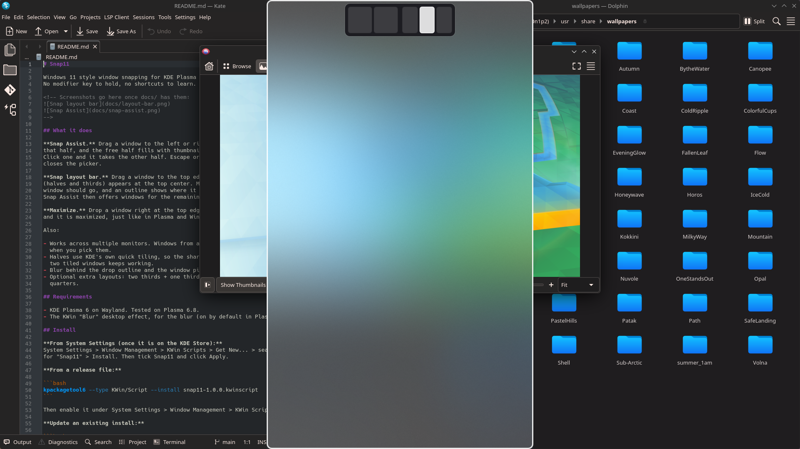
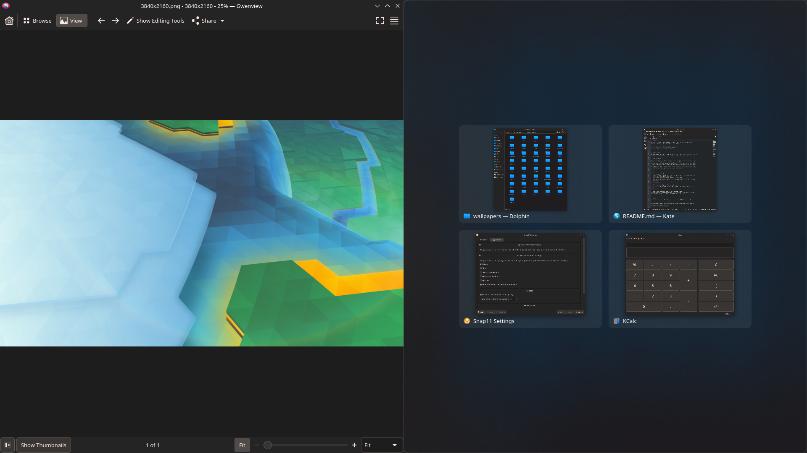

# Snap11

Windows 11 style window snapping for KDE Plasma 6, made for the mouse.
No modifier key to hold, no shortcuts to learn.





## What it does

**Snap Assist.** Drag a window to the left or right screen edge. It snaps to
that half, and the free half fills with thumbnails of your other windows.
Click one and it takes the other half. Escape or a click on empty space
closes the picker.

**Snap layout bar.** Drag a window to the top edge. A small bar with layouts
(halves and thirds) appears at the top center. Move over the slot where the
window should go, and an outline shows where it will land. Drop it there.
Snap Assist then offers windows for the remaining slots, one after another.

**Maximize.** Drop a window right at the top edge, away from the bar slots,
and it is maximized, just like in Plasma and Windows.

Also:

- Works across multiple monitors. Windows from another screen move over
  when you pick them.
- Halves use KDE's own quick tiling, so the shared resize handle between
  two tiled windows keeps working.
- Blur behind the drop outline and the window picker.
- Optional extra layouts: two thirds + one third, one third + two thirds,
  quarters.

## Requirements

- KDE Plasma 6 on Wayland. Tested on Plasma 6.8.
- The KWin "Blur" desktop effect, for the blur (on by default in Plasma).

## Install

**From System Settings (once it is on the KDE Store):**
System Settings > Window Management > KWin Scripts > Get New... > search
for "Snap11" > Install. Then tick Snap11 and click Apply.

**From a release file:**

```bash
kpackagetool6 --type KWin/Script --install snap11-1.0.0.kwinscript
```

Then enable it under System Settings > Window Management > KWin Scripts.

**Update an existing install:**

```bash
kpackagetool6 --type KWin/Script --upgrade snap11-1.0.0.kwinscript
```

Log out and back in after an update. KWin keeps the old version in memory
until then.

### One setting to change

Plasma maximizes a window when you drag it to the top edge. Turn that off so
the layout bar can take over (Snap11 maximizes by itself when you drop at the
top edge):

System Settings > Screen Edges > turn off **"Maximize: Drag windows to top edge"**.

Or in a terminal:

```bash
kwriteconfig6 --file kwinrc --group Windows --key ElectricBorderMaximize false
```

```bash
qdbus6 org.kde.KWin /KWin reconfigure
```

## Settings

System Settings > Window Management > KWin Scripts > Snap11 > configure
button.

- **Behavior:** turn Snap Assist and the layout bar on or off, choose the
  layouts in the bar, maximize at the top edge, trigger distance, include
  minimized windows, only offer windows from the same screen.
- **Appearance:** bar color and opacity, layout preview size, highlight
  color, drop outline fill and border, blur on or off, picker dimming,
  thumbnail size, corner radius.

## Known limits

- Only tested on Wayland. Plasma 6.6 on X11 is untested.
- Between two monitors, the shared inner edge does not trigger KDE's edge
  snapping, so Snap Assist does not open there. Use the layout bar instead.
- No snap groups yet (minimizing or resizing a group of snapped windows
  together).

## Troubleshooting

See what the script is doing:

```bash
journalctl --user -f | grep snap11
```

After a KWin update, if something looks off, log out and back in once.

## License

MIT, see [LICENSE](LICENSE).
